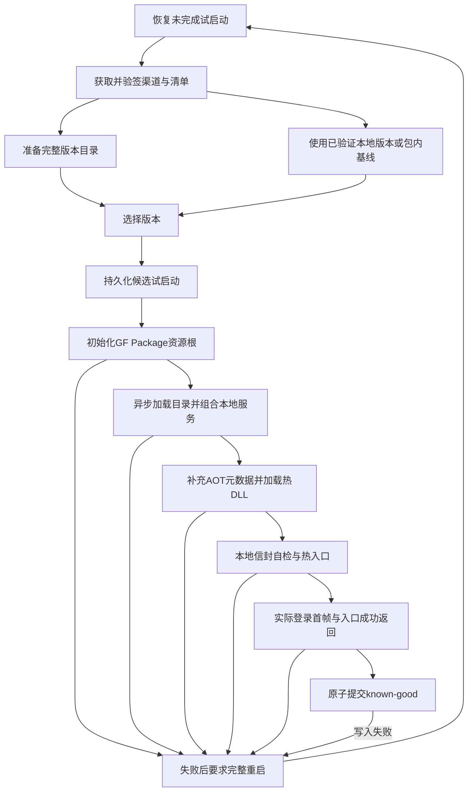

# 运行时架构

客户端采用 Unity IL2CPP、官方 GF/UGF 基线与 HybridCLR。自研运行时代码使用 C#，PowerShell 负责开发和构建编排。首期只有框架、默认本地模拟登录和显式 Tok 开发登录入口。

本文记录已提交的稳定运行时能力。F8 已在 Windows Release IL2CPP 与雷电 ARM64 APK 中接通包内信任、身份、发布源和服务组合，验证同主包更新、坏版下进程回退与更新端点不可达启动。D1 的正式构建管线与最终基线仍在实施；平台与任务完成范围见[实施进度](implementation-progress.md)。

## 目录与程序集

| 程序集 | 归属 | 主要依赖与作用 |
| --- | --- | --- |
| `Client.Contracts` | AOT，`Framework/Contracts` | 资源/UI/会话/日志/入口接口；部分接口使用 Unity 对象，因此不是完整的无 Unity .NET 层 |
| `Client.Protocol.Envelope` | AOT，`Framework/Protocol/Envelope` | 固定 Tok Frame v3 生成代码，依赖 Google.Protobuf |
| `Client.Framework` | AOT，`Framework` | 依赖 Contracts、Envelope、UGF、Unity UI、HybridCLR；实现资源、发布、加载、网络和 UI 基础能力 |
| `Client.Bootstrap` | AOT，`Framework/Bootstrap` | 依赖 Framework/Contracts/UI，承载启动宿主和内置更新页 |
| `Client.Game.Protocol` | 热更，`Game/Protocol` | 依赖 Contracts/Framework/Protobuf，正式业务 Registry 当前为空 |
| `Client.Game` | 热更，`Game` | 依赖 Contracts/Framework/Game.Protocol/UI/TMP，承载 Entry 和普通 C# 登录 Presenter |
| `Client.Editor` | 仅 Editor，`Editor` | 构建、归档、UI制作工具；不进入 Player |

表中目录均相对 `Assets/Scripts`。测试放 `Assets/Tests`，可更新资源放 `Assets/Content`。两个 Game 程序集均为 `autoReferenced=false`，HybridCLR 用显式 asmdef 名单管理它们。AOT 程序集不引用 `Client.Game*`；热更层可以调用已经编入 AOT 的 Framework 能力。

Proof/Test 程序集有独立条件与入口。其本地加载接口不作为正式签名发布的旁路。目录细则见[工程目录规划](project-layout.md)。

## 启动宿主与原生接线

- `Bootstrap.unity` 的 `GameFramework.prefab` 先启用 Base/Event/Download 等基础组件。
- `GameRoot.prefab` 保持未激活，选定完整资源目录后才创建和激活其中的 Resource/UI。
- `UIUpdate.prefab` 是包内更新、错误、重试和退出界面，不能依赖待加载的热更资源。

`Client.Bootstrap.ClientBootstrap.ConfigureLaunchAsync` 绑定 `ReleaseCoordinator`、`ResourceSlotBootstrap` 和异步源上下文工厂；`LaunchAsync(token)` 执行启动。配置只允许在启动前完成一次。原有同步 `ConfigureLaunch` 通过完成任务适配到同一路径。源工厂在实际资源初始化成功后执行，通过 `IClientContext` 提供 Resources/UI/Session/Log/Lifetime，并受现有本地就绪期限和取消令牌约束。

`NativeClientComposition.ComposeAsync` 从选中 GF Package 加载 UI 定义目录，再创建 UI 根和 UIService，使目录、布局与窗口来自同一资源图。返回的可释放上下文拥有 UI 服务、目录句柄、UI 根和可释放的宿主会话；组合失败会尝试全部清理并保留原始及清理错误。取消时迟到返回的上下文仍会释放，迟到失败保留到诊断记录。F8 已实际走通这条组合路径，D1 继续交付正式包内配置和统一构建入口。

`NativeLaunchConfiguration` 保存包内可信的 `PlayerIdentity`、入口类型名、期望就绪 ViewID 和本地就绪期限。默认入口是 `Client.Game.Entry`，默认 ViewID 是 `UILogin`。下载清单只能与包内身份比较，不能提供本地可信身份或替换信任公钥。

准备阶段可在旧版本仍可用时重试。资源初始化开始后进入不可逆启动范围；失败后要求完整重启，一个进程只激活一个资源根并尝试加载一个热更程序集集合。

图中的回到恢复节点表示下一个进程。直接复用完整本地版本时，不保证经过下载/物化阶段。

## 完整版本与状态事务

每个 release 是不可变完整快照，包含原生 GF Package、热 DLL、匹配原 Player 的元数据和签名配置。GF 原生版本表是资源资产索引；不引入 Addressables 或第二套资产目录。

`ReleaseStore.PrepareAsync` 只接受已经验签和兼容验证的 `VerifiedRelease`。复用旧文件前重新校验再复制，缺少的文件下载到暂存目录；长度与整文件 SHA-256 通过后同卷改名。空间预算覆盖完整物化、临时文件和64MiB余量。稳定版本不被原地改写。

暂存目录使用完整清单 SHA-256 的52字符大写 Base32（无 padding），保留全部256位，不改变 releaseId、slot 或文件名。客户端对实际规范化本地路径采用最多240个 UTF-8 字节（不含 NUL）的支持策略；物化前检查状态、暂存、目标、流与下载路径，并覆盖真实临时文件和 GF `.download` 后缀。超限时拒绝当前操作并保留可用版本。这是本客户端策略，不能据此声称所有 Android 文件系统都有同一限制；实际截断诊断与修复证据见[热更新验证](verification/hotupdate.md)。

`ReleaseStateStore` 保存 KnownGood、PreviousGood、Candidate、Attempt 和 BadReleaseIds。写入使用同目录临时文件、持久刷新及替换/备份；读取只接受结构及全部版本引用都有效的主文件或备份，不靠扫描 `.partial` 目录选择版本。签名文档与状态文档均有大小边界。

候选 C 持久化试启动后尚未就绪，下一个进程会隔离 C，选择当前已验证的 K 并保留更早的 P。K 自身失败时，原子更新到仍可用的 P。启动已有 known-good 也进入宿主启动范围，但不会因此将它记为新的候选 Attempt=1。

准备失败保留旧版本；本地启动失败保留原始原因、取消/清理和状态持久化的次生错误。`ReleaseDiagnostics.Failures` 是只读本地内存记录，不会自动写磁盘或发送遥测。更新页使用有限错误提示，不将原始异常和凭据直接显示给用户。清理只处理未被有效状态及备份引用的版本。

## 两个期限与本地就绪

准备预算为10分钟，从准备逻辑取得相应门禁并完成恢复后开始，覆盖渠道/清单网络读取、验签与版本准备。包内基线回退使用剩余预算。它不是整个 `LaunchAsync` 从入口起算的期限。

本地就绪预算默认30秒，可配置1秒至2分钟；在资源激活调用前创建启动 Lifetime 时开始，覆盖资源初始化、服务组合、AOT 元数据、热入口、首帧和状态提交。网络清单读取与 AOT 补充元数据加载属于不同阶段。成功提交后停止这个 deadline，页面仍受原有 Lifetime 控制。

本地Ready提交流程同时要求：

1. 实际选定资源根初始化成功，源上下文使用同一个 ResourceService。
2. 正式加载器完成匹配的元数据与热 DLL 加载。
3. 本地固定 Frame 编解码自检成功。
4. 配置期望的窗口（默认 `UILogin`）活跃 handle 呈现真实未来帧。
5. 捕获的当前 selection/context/epoch 请求 `IClientContext.ReportReady()`，相关 token 仍有效。
6. 热入口 `InitializeAsync` 真正成功返回，状态原子提交成功。

入口在首帧后请求 Ready，协调器还会等待入口成功返回才提交。过早请求不被缓存为以后自动生效；按字符串 releaseId 调用的兼容 Ready 形状缺少调用者代次，不能提交。服务器认证成功不属于本地版本健康条件。

`LocalReadinessGate` 验证本地就绪事实；协调器在门禁通过后执行状态持久化。`UIFirstFrame.WaitAsync` 绑定真实 `UIViewHandle` 与原生 serial，观察未来 Canvas 渲染和同帧 `WaitForEndOfFrame`，重新检查快照、可见性、透明度、生命周期和实例身份。关闭、取消或池复用使旧实例的等待失效；隐藏仅作废已记录的渲染证据，等待仍可在恢复后的新帧完成。无图形设备或 Editor batch 不制造假首帧；实际设备展示由平台验收覆盖。

## 资源、UI与所有权

`ResourceSlotBootstrap` 在 ResourceComponent.Start 前注入 `<slot>/Resources` 与 `<slot>/Scratch`，随后激活 GameRoot、等待真实 `InitResources` 完成。`IResourceService.LoadAsync<T>` 返回幂等可释放的 `IAssetHandle<T>`；取消后若 GF 才返回资源，无法交付的 handle 仍会释放。

UI Prefab 的加载/卸载由 GF UI helper 和 ResourceComponent 唯一拥有。`UIService` 管理 pending open、活跃窗口和原生 serial；`IViewHandle.Close()` 取消该窗口 Lifetime 并对称解绑。源上下文需要通过其 `IDisposable` 实现明确拥有 UI/session 等服务；稳定 `IClientContext` 本身不强制可释放，也不表示宿主会自动销毁它暴露的每项服务。

主窗口挂在 `AdaptiveUIRoot/Windows/<GF组>/UI{Name}`，Windows 是全帧直接子节点，与全局 SafeArea 同级。窗口根只有 RectTransform、Bridge 和 Bindings；UINode 上放 Canvas/CanvasGroup/GraphicRaycaster，不放独立 CanvasScaler。窗口局部 SafeArea 只应用一次，背景和模态遮罩覆盖全帧。

屏幕组件 Update 采样，LateUpdate 每帧最多发布一次有效变化。UIService 先更新全局 Canvas，再由 `UIViewBridge.Apply` 依次应用局部安全区、布局和键盘 baseline。未知键盘高度保留原几何并提供有界手动滚动；已知遮挡才调整 viewport。

UI定义、Prefab和Layout必须来自一致的GF资源图并保持对象匹配。将同GUID资产的包内原生副本与Bundle副本混用，会产生不同Unity对象；原生组合必须在资源初始化后正确加载所需定义，并将定义资源句柄保留至UI服务结束，不能放宽布局身份检查或同步阻塞Unity主线程。

热更登录由 `UILogin.cs`、`UILogin.State.cs`、`Generated/UILogin.G.Bindings.cs` 组成同一个普通 `sealed partial`。生成器只维护绑定。默认 Entry 加载 LocalSimulationProfile，自行拥有模拟会话；`TokDevelopmentEntry` 显式选择开发profile并使用宿主会话。完整制作规则见[UI规范](ui-authoring.md)。

## 网络与协议

所有可编辑 proto 位于 `comm/proto`；客户端保存生成物。AOT固定信封为Tok Frame v3，正式业务注册表为空；新增测试Parser位于隔离fixture，不能据此宣称业务协议已接入。

`FrameCodec` 使用4字节大端长度前缀，body为1至1MiB，解码要求恰好一帧。传输默认连接5秒、整帧读/写各15秒，每方向最多64帧/4MiB；接收预算覆盖进行中、排队和交付宿主持有的帧。GF宿主按连接代次在主线程交付，避免第二个无界队列和旧泵更新新连接。

`SessionClient` 同时只允许一个登录，连接与登录期限各默认5秒。请求ID使用精确ulong并拒绝耗尽回绕；响应需匹配请求、版本和身份字段。token仅保存在内存，不进入日志。SessionOptions要求调用方提供地址；开发约定端口不是运行时内置服务器。

首期接口只有 LoginAsync、Disconnect、StateChanged；不包含完整业务发送、心跳、自动重连、ACK/Resume/刷新恢复或请求回放。详情见[Tok接入契约](tok-demo-protocol.md)。

## 热更新与构建边界

正式 `HotfixAssemblyLoader.LoadOnce` 只接受 `PreparedRelease` 和原生身份。它先占用进程一次尝试，再重新校验实际文件和程序集身份/依赖，补充原始AOT元数据，按 `Client.Game.Protocol` → `Client.Game` 加载并创建配置的入口。每只元数据加载返回码必须成功；失败也不释放一次尝试门禁。

`PlayerBaselineArchive.Stage/Finalize/Open` 管理原始平台基线。生成需达到有界固定点，最终Player的post-strip字节必须与包内元数据逐文件一致；完成归档需要实际原生产物与 `archive.json`，不是 Library 路径或 `pending.json`。Stage产生归档身份与待完成归档；PlayerBuildId/metadataSetId作为构建拥有的包内数据写入最终Player，身份读取代码、信任pin与profile先于固定点冻结。F8 两平台技术基线已验证这些约束，D1 的最终基线仍须独立生成和归档。

兼容检查使用原始归档及官方MissingMetadataChecker，并严格比较七个固定编译引用：Contracts、Framework、Envelope、HybridCLR.Runtime、Google.Protobuf、Unsafe、netstandard编译reference。编译reference、签名的纯forwarder facade与实际AOT实现是不同材料；facade不作为AOT元数据加载。补丁不能重新生成并替换原Player元数据。

UI资源值与允许的Game代码改动可以走补丁。引擎、原生SDK、稳定契约、固定信封、AOT组成、固定库或裁剪/构建输入改变，需要新Player。生成公钥/profile材料也必须能够重建原归档的编译输入，不能用默认空pin的不同Framework输出冒充原包兼容。

## 关闭与支持范围

显式 `ShutdownAsync` 使用共享完成任务，防止重入；入口关闭有独立有界等待，随后尝试全部拥有的清理并保留错误。`OnDestroy` 是同步取消/Dispose兜底，不等价于等待热入口异步关闭完成。一次性资源根和程序集门禁不会因关闭而重置。

首期平台为Windows x64与雷电中的Android ARM64。真实ARM硬件/性能和iOS未被这套源码与Editor结果自动证明；iOS当前还缺少容量查询、运行平台与归档目标适配，后续见[iOS清单](ios-follow-up.md)。迁移范围见[迁移台账](migration-ledger.md)。
