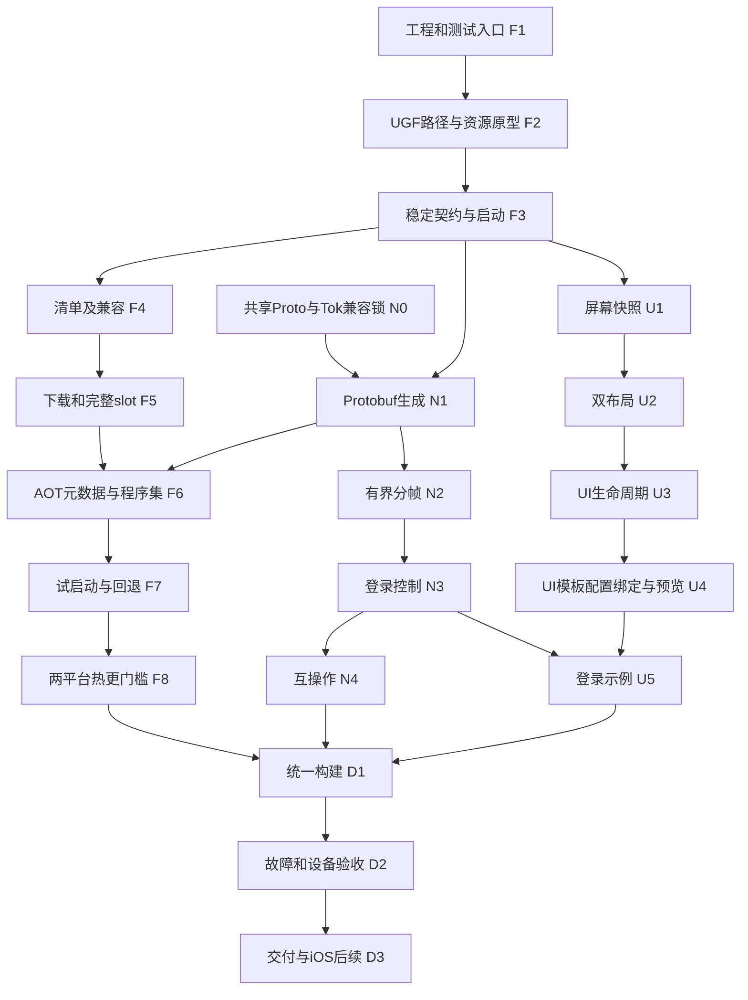

# 全 C# 竖屏客户端框架 Implementation Plan

> **For agentic workers:** REQUIRED SUB-SKILL: Use superpowers:subagent-driven-development (recommended) or superpowers:executing-plans to implement this plan task-by-task. Steps use checkbox (`- [ ]`) syntax for tracking.

**Goal:** 在 `E:/sgame/client` 建立竖屏优先、横竖屏自适配、Protobuf 通信、可发布 C# 代码与资源热更新的 Unity 框架，并以无业务登录页证明完整链路。

**Architecture:** 干净 GameFramework 承担基础模块，HybridCLR 承担 IL2CPP 下 C# 程序集加载；AOT 启动器控制签名清单、完整版本目录和回滚，热更层承载登录及未来业务。资源使用原生 GF Package 索引，完整快照按 release 切换；Protobuf 固定信封在 AOT，未来业务类型在热更程序集。

**Tech Stack:** Unity 2022.3.25f1（兼容门槛后锁定）、GameFramework/UnityGameFramework 官方基线、HybridCLR 9.0.0 社区版、uGUI、TextMeshPro、Google.Protobuf 3.36.2、C#、IL2CPP。

**Spec:** [设计基线](../specs/2026-10-28-csharp-hotupdate-framework-design.md)。2026-10-29用户已要求实现并检测；当前执行状态见[实施进度](../../implementation-progress.md)。

## Global Constraints

- 工作目录 `E:/sgame/client`；参考工程 `E:/hygd/work/client` 保持只读。
- 自研代码按`Assets/Scripts/Framework`、`Assets/Scripts/Game`、`Assets/Scripts/Editor`划分；Framework为AOT基础设施，Game为热更应用/业务，Unity测试放Assets/Tests。目录规范见[工程目录规划](../../project-layout.md)。
- Android ARM64、Windows x64 为首期；iOS 保留兼容设计，明确不做首期验收。
- Android首期按用户2026-10-29选择使用雷电运行ARM64 APK，记录实际ABI/转译环境；真机硬件兼容/性能另列未验证，不将模拟器结果混写为真机。
- 项目自有运行时代码全 C#；不复制 Lua、XLua、旧 MessagePack/JSON 网络链或旧 SDK。
- 自研标识符、文件和资源名中的UI缩写统一大写，具体命名规则遵循工程目录规划。
- 首期仅框架和登录示例；无地图、战斗、英雄、公会、经济、支付或完整游戏配置迁移。
- 代码热更必须由实际 IL2CPP Player 验证，Editor/Mono 不代替。
- 一次进程只初始化一个资源根、加载一个热更程序集集合；失败回退以完整重启为边界。
- AOT 补充元数据按平台及 PlayerBuildId 归档；补丁复用原归档，不重新生成替换。
- 共享协议唯一构建源为`E:/sgame/comm/proto`；N0按Tok当前canonical定义建立兼容信封和来源锁，Frame.version=3，改变固定信封需要新Player并协调服务端；客户端仅保存生成C#。
- UGF 原生 Package 为唯一资产索引；只允许通用路径注入补丁，不导入旧 fork。
- 本计划的 PowerShell 仅作开发/构建编排，客户端运行时代码仍全部 C#。
- 新源码 UTF-8 无 BOM、LF；资源与 `.meta` 配对；依赖许可保留，缓存、输出、私钥和个人配置不提交。

## Review Focus

1. 下载/启动各阶段被强杀：下一进程只选完整且兼容版本，不混用 DLL 与旧资源；F4/F5/F7、D2 验证。
2. 新热代码引用已裁剪 AOT API或错误平台元数据：发布门禁拒绝，不能等用户设备崩溃；F6、D1 验证。
3. 登录请求中旋转、返回、取消和页面关闭：输入保留，旧回调不能写新页面；N3、U2/U3 验证。
4. 超长/半帧/粘包及迟到响应：分配前校验，有界排队，只有当前连接代次更新状态；N2/N3 验证。
5. 一个修改只在 Editor 生效或偷带进新主包：用同一 APK/EXE hash、独立 v1/v2 发布和可执行分支证明热更；F8、D2 验证。

## 1. 本轮交付物与实施入口

本轮只交付本文、设计基线、三份子计划、[工程目录规划](../../project-layout.md)、[UI编辑规范](../../ui-authoring.md)和[Tok demo接入契约](../../tok-demo-protocol.md)。以下文件、场景、脚本和命令均是后续实施任务，不代表已经存在或已通过验证。

| 子计划 | 内容 | 独立验收点 |
| --- | --- | --- |
| [01 基础与热更新](2026-10-28-csharp-hotupdate-framework-01-foundation-hotupdate.md) | F1–F8：工程、框架、发布事务、元数据、加载、回退 | 同一 IL2CPP 主包运行热更 v2 |
| [02 Protobuf 与会话](2026-10-28-csharp-hotupdate-framework-02-protobuf-session.md) | N0–N4：comm/proto共享源、生成器、分帧、登录控制、互操作 | C# ↔ Tok Frame v3 与故障用例 |
| [03 UI、登录与交付](2026-10-28-csharp-hotupdate-framework-03-adaptive-ui-delivery.md) | U1–U5、D1–D3：自适配、制作工具、生命周期、登录示例、发布验收 | C# UI制作流程、Android/Windows热更与横竖屏矩阵 |

实施前重新读取本地约束、设计与三份 Interfaces，核对工具/依赖实际版本。每项按测试→观察失败→最小实现→通过→单独提交推进；测试基础设施、资产制作和文档归到其所属交付物，不为微小动作另开分支。

## 2. 推荐顺序与依赖



第一个技术门槛是F2的原生资源路径初始化；F3先做Windows最小C#热更闭环，F8再完成两平台和回退门槛。N0可独立验证共享Proto源，N1依赖N0/F3；N1–N4和U1–U3可在接口确定后并行。F8未通过前不扩展UI美术或通用业务组件。F6额外依赖N1的Protobuf运行库，N4不依赖D2设备验收，避免循环依赖。稳定契约D1最终主包归档后冻结，之后变更必须新Player；共享接口由同一负责人维护。

## 3. 从旧工程迁移什么

| 材料 | 首期动作 | 新落点/验收 |
| --- | --- | --- |
| Procedure/Fsm/Event/Pool/UI 模块 | 从官方基线安装并锁定；参考旧注册习惯，去掉大 GameEntry 单例面 | Runtime 适配与显式 IClientContext，F1/F3/U3 |
| 旧启动/更新/LoadingManager | 参考阶段进度和失败提示，重新写单一 AOT 流程 | Bootstrap → release → hotfix → Login，F3–F7 |
| Addressables 定制 ResourceManager | 不复制；选择原生 GF Package + 完整 slot | F2 原型与 F5 完整闭包 |
| 旧 UICanvasScaler | 不复制实现 | 宽高比浮点判定、动态快照与双布局，U1/U2 |
| 旧 UISafeArea | 参考归一化算法；去掉历史机型补丁 | SafeAreaRoot，U1/U2 |
| Lua UI MVC | 只参考生命周期；重做 C# Bridge/Presenter | 同窗口旋转不重建，U3/U5 |
| UI模板、UIConfig、GUILink/控件导出与合规检查 | 参考实际编辑流程，改成C#绑定生成及预览；明确旧规则和新规范 | UI编辑规范与U4，不迁入Lua依赖 |
| MessagePack/JSON/PacketHandler | 不复制协议或分发 | 固定 Protobuf Frame、有界队列，N2/N3 |
| 旧重连器 | 仅把异常用例作为参考；不复制 SDK/业务分支 | 首期明确断线，完整 Resume 后置，N3 |
| 旧配置启动会话/计时 | 参考取消代次、完成屏障、阶段日志；不迁移游戏表 | Bootstrap/Release 诊断，F3/F5 |
| 旧 Build/PowerShell 工具 | 参考单入口、结果文件、原资源隔离；重新写小型工具 | 同结果路径、稳定输出、D1 |
| SDK/IAP/上报、技能/地图编辑器、全部 SLG 业务和美术 | 不迁移 | 后续有具体需求再立计划 |
| comm/proto | 按Tok当前canonical建立完整兼容信封与来源锁，作为共享协议唯一源 | N0 |
| comm通用生成/兼容工具 | 复用逻辑，显式传共享ProtoRoot/ProtocolLock，缺必需源即失败 | N1/N4 |
| comm 业务 Lua 生成器 | 新增 CSharp 目标，保留旧默认行为 | 不产生新客户端 Lua 依赖，N1 |
| tok | 只读协议、用现有 demo 联调；不改核心 | N4，不建立旧 Java/SLG 兼容层 |

## 4. 逐 Task 验收台账

每个Task完成后更新“未开始→实施中→验证通过/阻塞”，附本次runId和证据。前置Task未通过时，不能用后置Task绕过；独立分支可以准备代码，但不宣称集成完成。

| Task | 前置 | 一次只交付的结果 | 通过条件/证据 |
| --- | --- | --- | --- |
| F1 | 无 | 工程、锁与测试入口 | Bootstrap单宿主；两目标IL2CPP编译；依赖锁 |
| F2 | F1 | 原生资源slot初始化 | 同Player两次冷启动读A/B；初始化后禁止换根 |
| F3 | F2 | 稳定接口与最小C#热更 | Windows同Player执行新类型/分支42 |
| F4 | F3 | 签名与兼容门禁 | 篡改/错误身份/越界路径全部在加载前拒绝 |
| F5 | F4 | 完整slot与原子状态 | 每个中断点旧版不变，新版只有完整后prepared |
| N0 | 无 | 共享Proto与Tok兼容锁 | 完整信封hash/来源锁正确，改字段/编号/锁和缺源负例拒绝 |
| N1 | N0、F3 | CSharp协议生成 | 从comm/proto生成；空注册表/增量fixture/锁校验通过 |
| F6 | F5、N1 | AOT元数据与加载门禁 | 正确归档加载；缺AOT API要求新Player；泛型probe |
| F7 | F6 | 试启动与下进程回退 | 迟到Ready无效，坏版下一进程回退，登录错误不拉黑版本 |
| F8 | F7 | 双平台热更核心闭环 | 雷电中的ARM64 APK/Windows同主包v1→v2与坏版回退 |
| N2 | N1 | 有界分帧与传输 | 包长/分片/粘包/EOF/期限/队列上限全通过 |
| N3 | N2 | 登录控制状态机 | 成功/拒绝/取消/迟到/断线及uint64边界 |
| N4 | N3 | C#/Tok互操作 | Rust发C#读、C#发Rust读、真实demo登录；无业务迁移 |
| U1 | F3 | 屏幕快照 | 方向/安全区/零尺寸/去重事件通过 |
| U2 | U1 | 自适应布局 | 分辨率矩阵、交互安全区、输入实例保持、短窗可滚动 |
| U3 | U2 | UI窗口生命周期 | 20次开关无重复订阅，取消释放，Popup层级正确 |
| U4 | U3 | UI制作工具与规范 | 模板/配置/引用/生成/校验/预览闭环，生成不覆盖手写代码 |
| U5 | U4、N3 | 热更登录示例 | 按UI规范制作，无业务页面，旋转保留状态，首帧只ReportReady一次 |
| D1 | F8、N4、U5 | 最终Player与补丁构建 | 同入口结果、互斥/恢复、归档/签名/兼容门禁 |
| D2 | D1 | 真实设备综合验收 | 两平台所有required case有本run证据，无NotRun冒充Pass |
| D3 | D2 | 可复现交付文档 | 干净checkout按README跑通，iOS后续项明确未测 |

## 5. 目标目录

完整目录、程序集归属、版本管理和共享工具路径约束见[工程目录规划](../../project-layout.md)。摘要如下：

```text
client/
  Assets/
    Scripts/
      Framework/                  AOT基础设施
        Bootstrap/                独立AOT启动程序集
        Contracts/                稳定接口与DTO
        Core/                     纯C#基础能力
        Release/                  清单、事务、试启动、回滚
        Resource/                 原生GF资源适配与句柄
        HotUpdate/                元数据与DLL加载
        Protocol/Envelope/        固定信封生成物
        Network/{Core,Unity}/     有界传输/会话及GF宿主
        UI/                       屏幕、安全区、布局、窗口Bridge
        Platform/                 平台基础接口
      Game/                       C#热更应用，Entry与Login功能
        Protocol/                 独立热更业务协议程序集
      Editor/{Build,UI}/          自研编辑器工具
    Scenes/Bootstrap.unity        启动场景
    Prefabs/App/                  GameFramework/GameRoot/UIUpdate
    Content/UI/{Common,Login}/ 可更新Prefab、布局和文案
    Settings/Environment/         环境配置资产
    ThirdParty/{GameFramework,Protobuf}/ 第三方代码和许可
    Tests/{EditMode,PlayMode}/    Unity测试程序集
  Packages/                       官方UPM依赖配置
  ProjectSettings/                Unity工程设置
  Tool/Client/                    仅开发/构建编排
  Tests/{Fixtures,Managed}/       隔离测试输入与独立.NET测试
  Builds/                         忽略的产物和证据
  docs/                           目录规范、设计和Task计划
```

## 6. 里程碑完成定义

- [x] **M0 可复现基线**：F1/F2，通过 Editor 导入、路径原型和 Android/Windows IL2CPP 编译；依赖有版本/提交和许可记录。
- [ ] **M1 热更可用**：F3–F8，原主包不变，v2 新 C# 代码分支执行，坏版能下次启动回退。
- [ ] **M2 协议可用**：N0–N4，从comm/proto独立生成，固定信封匹配Tok v3；有界分帧、登录、取消、Tok黄金帧和真实demo TCP7000通过。
- [ ] **M3 UI框架可用**：U1–U5，参考旧工程的制作/配置/绑定/检查流程落地为C#工具；竖屏优先、横屏重排、安全区/键盘/旋转保留输入，无具体业务。
- [ ] **M4 交付可复核**：D1–D3，雷电ARM64 APK功能验证+Windows Release IL2CPP完整矩阵、SHA/结果文件、故障回退证据齐全，真实ARM硬件未测限制明确。

## 7. 暂缓项

完整业务请求/通知、ACK/Resume/刷新恢复体系、生产认证/加密网关、商店和渠道 SDK、iOS Mac/Xcode/实机验收、自动程序集卸载或运行中原地替换、资源按需流式加载、虚拟文件系统和跨版本文件去重、编辑器/策划表工具、游戏玩法。

这些后置项不允许在首期 UI 显示成已支持；首期完成声明只覆盖 M0–M4。

## 8. 执行与评审建议

推荐按子计划逐任务实施，并在 F2、F8、N4、D2 设独立评审点。核心热更新链涉及 AOT、资源事务和跨平台发布，适合任务实现与独立审查交替推进。也可在当前会话由同一实现者按接口顺序完成，再做整体审查。

2026-10-29用户已明确要求实现本计划并进行检测，现按Task及实施进度持续推进。本地实现、依赖安装、生成、构建、测试和提交在目标范围内；外部发布、推送和合并另按实际授权执行。
